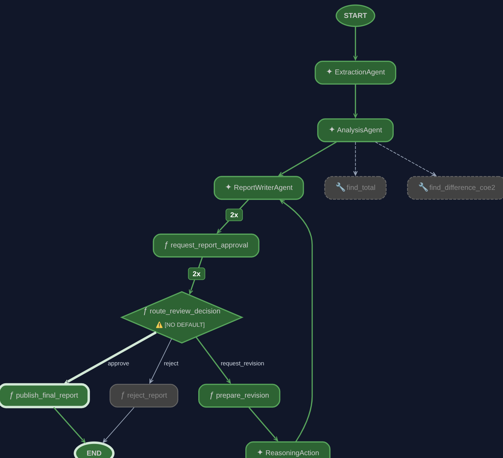

# Climate AI Management

**An Agentic AI System for Carbon Footprint Analysis, Auditing, and Human-Supervised Report Publication**

Climate AI Management is a Python-based multi-agent application built with **Google Agent Development Kit (ADK), Google Vertex AI, and Gemini**.

The project demonstrates how enterprise-oriented agentic workflows can automate carbon footprint document analysis, perform deterministic numerical checks, enforce security policies, coordinate human review, and manage the controlled publication of environmental assessment reports.

The system combines LLM-powered agents with structured data validation, custom Python Function Tools, conditional graph orchestration, and Human-in-the-loop mechanisms.

## 1. Project Objectives

The primary objective is to design and implement a modular, extensible agentic system capable of:

- Processing carbon footprint documents, including PDF files.
- Extracting structured environmental and emissions information.
- Analyzing greenhouse gas emissions and identifying inconsistencies.
- Performing deterministic calculations through Python Function Tools.
- Generating structured carbon footprint assessment reports.
- Validating the information exchanged between agents.
- Applying input and output security controls.
- Supporting human approval, rejection, and report revision.
- Publishing reports only after explicit human authorization.
- Providing execution observability through Google ADK Web.

The application is intended as an engineering prototype demonstrating agent orchestration, tool integration, workflow control, and responsible AI development.

## 2. Technology Stack

| Layer | Technology | Purpose |
|---|---|---|
| Programming language | Python 3.12 | Application development |
| Agentic framework | Google ADK 2.x | Agent development and orchestration |
| LLM provider | Google Vertex AI | Managed model access |
| Language model | Gemini | Document interpretation and analysis |
| Orchestration | ADK Graph Workflow | Sequential and conditional execution |
| Data validation | Pydantic V2 | Structured schemas and validation |
| Function Calling | ADK Function Tools | Deterministic Python operations |
| Security | Google Model Armor | Input/output content screening |
| Human supervision | ADK RequestInput / Tool Confirmation | Human review and approval |
| Document processing | Gemini multimodal / PyMuPDF | PDF interpretation and text extraction |
| Development interface | ADK Web | Testing, debugging, and observability |
| Debugging | VS Code / debugpy | Breakpoints and Python inspection |

## 3. System Architecture

The application follows a graph-orchestrated multi-agent architecture.

```text
                    User / PDF Document
                            |
                            v
                   Google ADK Web
                            |
                            v
                 Google Model Armor
                            |
                            v
                      Graph Workflow
                            |
                            v
                    ExtractionAgent
                            |
                            v
                  ExtractionSchema
                     + Callbacks
                            |
                            v
                    AnalysisAgent
                            |
                  +---------+---------+
                  |                   |
                  v                   v
             find_total()      find_difference_coe2()
                  |                   |
                  +---------+---------+
                            |
                            v
                     AnalysisSchema
                       + Callbacks
                            |
                            v
                    ReportWriterAgent
                            |
                            v
                      ReportSchema
                       + Callbacks
                            |
                            v
                     Human Review
                       RequestInput
                            |
                            v
                     Decision Router
                            |
              +-------------+-------------+
              |             |             |
              v             v             v
           APPROVE        REJECT      REQUEST_REVISION
              |             |             |
              v             v             |
        Publish Report     END            |
              |                          |
              v                          |
             END                 Prepare Revision
                                         |
                                         v
                                  ReportWriterAgent
```




The workflow uses shared session state to transfer structured information between agents. Conditional routing is driven by validated human decisions rather than autonomous LLM approval.

## 4. Multi-Agent Components

### 4.1 ExtractionAgent

The ExtractionAgent processes environmental documents and extracts relevant information using Gemini through Vertex AI.

Its responsibilities include identifying company information, reporting years, Scope 1, Scope 2 and Scope 3 emissions, declared emission totals, supporting evidence, and missing information.

The agent produces a structured result defined by `ExtractionSchema`, stored in the ADK session state using:

```python
output_key="extracted_data"
```

### 4.2 AnalysisAgent

The AnalysisAgent consumes `extracted_data` and performs environmental data analysis.

It identifies discrepancies, incomplete disclosures, methodological limitations, and potential reporting inconsistencies.

Instead of relying exclusively on LLM-generated calculations, the agent can call deterministic Python tools:

```python
find_total()
find_difference_coe2()
```

These tools calculate emission totals and numerical differences.

The agent stores its structured output as:

```python
output_key="analysis_result"
```

### 4.3 ReportWriterAgent

The ReportWriterAgent receives extracted information and analytical findings, generating a structured environmental assessment report.

The report includes an executive summary, emissions overview, anomalies, limitations, recommendations, and a non-certification disclaimer.

The output is validated against `ReportSchema` and stored in the session state as `final_report`.

The report-writing stage is also designed to support revision feedback and iterative regeneration without necessarily repeating document extraction and analysis.

### 4.4 Human Review

The Human Review component introduces explicit human supervision before report publication.

The architecture supports three decision types:

```python
approve
reject
request_revision
```

Google ADK provides mechanisms such as `ToolContext.request_confirmation()` and `RequestInput` to suspend execution and collect human feedback.

Human decisions are validated using a Pydantic model and associated with the relevant report version.

The conditional revision workflow is under active development and testing.

## 5. ADK Workflow Orchestration

Google ADK Graph Workflow coordinates agent execution and manages transitions between components.

The system implements several agentic design patterns:

**Sequential execution:** ExtractionAgent, AnalysisAgent, and ReportWriterAgent execute in a defined order.

**Shared state:** Agent outputs are stored through ADK session state and accessed by subsequent agents.

**Function Calling:** LLM agents invoke Python functions to perform deterministic operations.

**Lifecycle callbacks:** Before-agent and after-agent callbacks perform validation at execution boundaries.

**Conditional routing:** Workflow nodes select execution branches based on validated human decisions.

**Human-in-the-loop:** Execution can be suspended to obtain explicit human authorization.

**Revision loop:** A requested revision can return execution to ReportWriterAgent using reviewer feedback.

## 6. Structured Data Validation

Pydantic V2 is used to define and validate structured information exchanged between agents.

The project includes schemas for extraction, analysis, reporting, and human decisions.

Google ADK lifecycle callbacks perform validation at agent boundaries through `CallbackContext`.

Examples include:

```python
before_agent_callback=validate_state(...)
after_agent_callback=validate_state(...)
```

These mechanisms validate data structure and required fields.

Structural validation does not independently establish the factual accuracy of extracted information; separate deterministic and document-based verification may be required.

## 7. Function Calling and Deterministic Operations

Custom Python Function Tools extend the analytical capabilities of the LLM agents.

For example, the system processes the following emissions:

| Emissions category | Value |
|---|---:|
| Scope 1 | 120 tCO2e |
| Scope 2 | 80 tCO2e |
| Scope 3 | 15 tCO2e |
| Calculated total | 215 tCO2e |
| Declared total | 250 tCO2e |
| Difference (calculated − declared) | −35 tCO2e |

The tools perform numerical operations, while AnalysisAgent interprets their results and identifies limitations.

Function calls and responses are observable through ADK Web Events and Traces.

## 8. Security and Guardrails

Google Model Armor is integrated at the ADK application level through `ModelArmorPlugin`.

The project uses two configurable security templates:

```text
climate-prompt-guardrails
climate-response-guardrails
```

The prompt template screens incoming content, including potential prompt injection and jailbreak attempts.

The response template applies configured security filters to generated content.

Security screening complements, rather than replaces, Pydantic validation and deterministic numerical checks.

Blocked responses and structured-output handling require particular attention to ensure graceful error management.

## 9. Human Approval and Report Publication

Report publication is governed by explicit human authorization.

Each report version is associated with a SHA-256 identifier generated from a consistent JSON representation of the structured report.

The approval and publication mechanisms compare report identifiers to ensure that authorization applies to the intended version.

The publication component checks the approval state before recording the approved report.

At the current prototype stage, publication refers to recording the approved report and its publication status in ADK session state.

Generating downloadable PDF documents and storing them as ADK Artifacts are planned extensions.

## 10. Project Structure

```text
climate-ai-management/
|
├── pyproject.toml
├── README.md
├── .env
├── .vscode/
│   └── launch.json
│
├── public/
│   ├── data/
│   └── images/
│
├── src/
│   └── climate_ai_management/
│       ├── __init__.py
│       ├── agent.py
│       ├── config.py
│       ├── main.py
│       │
│       ├── agents/
│       │   ├── extraction_agent.py
│       │   ├── analysis_agent.py
│       │   ├── report_agent.py
│       │   ├── human_approval_agent.py
│       │   └── workflow.py
│       │
│       ├── callbacks/
│       │   └── validation_callbacks.py
│       │
│       ├── schemas/
│       │   ├── extraction_schema.py
│       │   ├── analysis_schema.py
│       │   ├── reporting_schema.py
│       │   └── decision_model_validator.py
│       │
│       ├── services/
│       │   ├── document_parser.py
│       │   └── report_manager_identity.py
│       │
│       ├── tools/
│       │   ├── math_operations.py
│       │   ├── human_in_loop.py
│       │   └── review_routing.py
│       │
│       └── nodes/
│
└── tests/
    ├── document_parser_test.py
    ├── test_extraction_agent.py
    ├── test_extraction_schema.py
    ├── test_final_workflow.py
    └── test_pydantic.py
```

The structure is representative of the current source layout. Additional supporting files may be present. The extraction schema filename should match the actual Python module used in the repository.

## 11. Installation

### Prerequisites

The development environment requires:

- Ubuntu or another compatible operating system.
- Python 3.11–3.13 (Python 3.12 recommended).
- Google Cloud CLI.
- A Google Cloud project with the relevant AI APIs enabled.
- Valid Google Cloud Application Default Credentials.
- Appropriate Vertex AI and, where applicable, Model Armor permissions.
- An active billing arrangement or eligible promotional credits for chargeable services.

### Clone or open the project

Navigate to the project directory:

```bash
cd climate-ai-management
```

### Create the virtual environment

If no virtual environment exists:

```bash
python3.12 -m venv venv_climate
```

Activate it:

```bash
source venv_climate/bin/activate
```

### Install dependencies

Install the project in editable mode:

```bash
python -m pip install --upgrade pip
python -m pip install -e .
```

The dependencies are defined in `pyproject.toml`.

For Google Model Armor integration, the installed ADK distribution must include the necessary Google Cloud dependencies, such as those available through the `gcp` extra.

## 12. Google Cloud Configuration

### Authenticate with Google Cloud

Configure Google Cloud CLI:

```bash
gcloud init
```

Then configure Application Default Credentials:

```bash
gcloud auth application-default login
```

### Environment configuration

Create a `.env` file in the project root.

Example:

```env
GOOGLE_GENAI_USE_VERTEXAI=TRUE
GOOGLE_CLOUD_PROJECT=your-google-cloud-project-id
GOOGLE_CLOUD_LOCATION=global
GOOGLE_CLOUD_MODEL_ARM_REGION=us-central1
```

The precise environment-variable names for Vertex AI or Agent Platform should match the installed version of Google ADK and Google Gen AI SDK.

`GOOGLE_CLOUD_MODEL_ARM_REGION` is an application-specific configuration variable used by the project's Model Armor setup.

Do not commit credentials, API keys, or local authentication files to the repository.

## 13. Running the Application

The primary development interface is Google ADK Web.

From the project root, activate the Python environment:

```bash
source venv_climate/bin/activate
```

Start the server:

```bash
adk web --host 127.0.0.1 --port 8000 src
```

Open:

```text
http://127.0.0.1:8000
```

In ADK Web:

1. Select `climate_ai_management`.
2. Create a new session.
3. Upload a carbon footprint PDF document.
4. Submit a document analysis request.
5. Inspect the execution through Events and Traces.
6. Review structured results through Session State.
7. Complete the Human Review step when requested.

ADK Web is intended for local development, testing, and debugging rather than as a production-facing client portal.

## 14. Testing and Debugging

The project includes individual tests for document processing, structured extraction, Pydantic schemas, and workflow execution.

A workflow can also be executed programmatically through the Google ADK Runner.

For local debugging, start ADK Web with:

```bash
adk web --no-reload --log_level DEBUG \
  --host 127.0.0.1 --port 8000 src
```

VS Code can be configured to launch the ADK server under `debugpy`, enabling breakpoints inside Python Function Tools, callback functions, and workflow nodes.

ADK Web provides:

- **Events:** execution events, model outputs, tool calls, and state updates.
- **Traces:** execution hierarchy and timing.
- **State:** shared agent outputs and workflow state.
- **Artifacts:** generated or stored files where supported.
- **Evals:** evaluation datasets and results.

## 15. Current Capabilities and Limitations

The prototype has demonstrated successful execution of document extraction, analysis, report generation, deterministic Function Calling, structural validation, Model Armor screening, and human approval.

Conditional revision routing and structured human feedback are being refined.

Current limitations include the need for more comprehensive evaluation, handling of certain blocked responses, robust session persistence, and generation of downloadable final documents.

The system produces preliminary environmental assessments. It does not replace certified greenhouse gas inventory verification or independent third-party assurance.

## 16. Development Roadmap

Planned enhancements include:

- Complete and test conditional revision loops.
- Introduce revision limits and report version history.
- Generate approved PDF reports.
- Save generated documents using ADK Artifact Service.
- Implement comprehensive ADK Evaluation datasets.
- Improve recovery from errors and blocked security responses.
- Introduce persistent audit logs and session management.
- Extend observability and enterprise monitoring.
- Evaluate Agent2Agent (A2A) interoperability with external agents.

## 17. Security and Responsible Use

This project follows a human-supervised approach to AI-assisted environmental reporting.

LLM-generated information must be validated before publication. Numerical calculations should use deterministic tools where appropriate, while human approval must remain explicit and associated with the correct report version.

Model Armor provides additional content-security screening but does not certify factual accuracy.

Sensitive documents should be processed only with the necessary permissions, appropriate cloud security configuration, and relevant data-governance controls.

## 18. License and Intended Use

Climate AI Management is an experimental engineering project intended for technical demonstrations, learning, testing, and agentic system architecture evaluation.

It is not an official South Pole product or a certified environmental auditing platform. The project description does not imply endorsement by or affiliation with South Pole.

A software license should be specified separately before public redistribution.